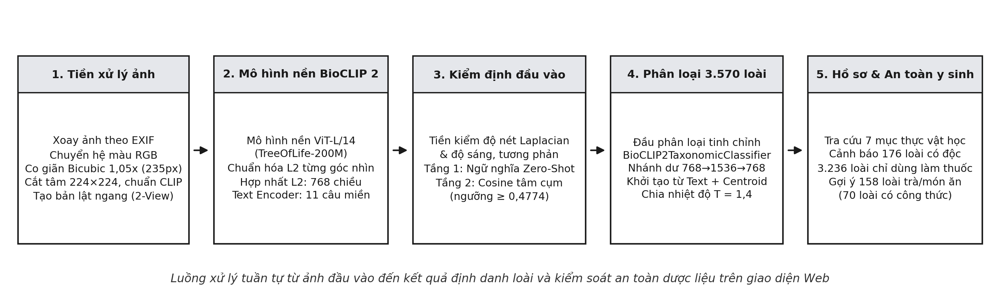
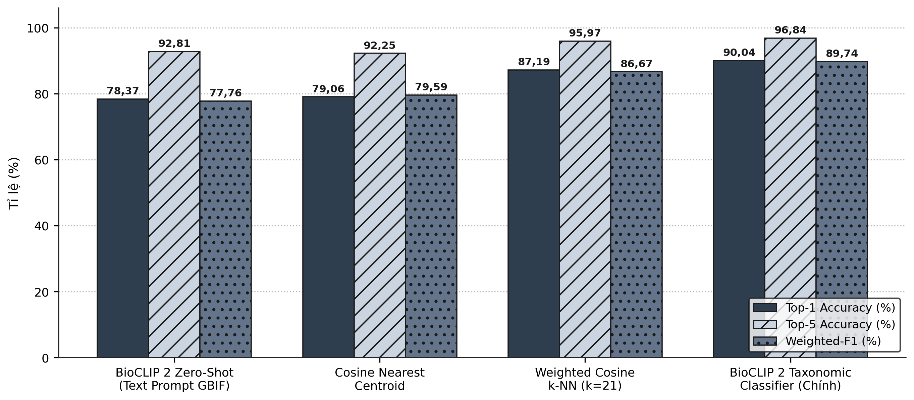
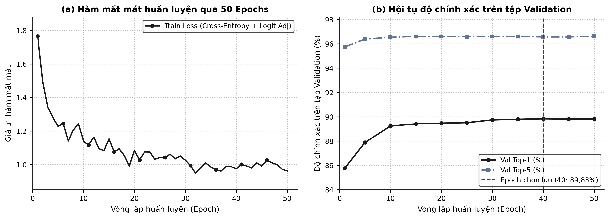
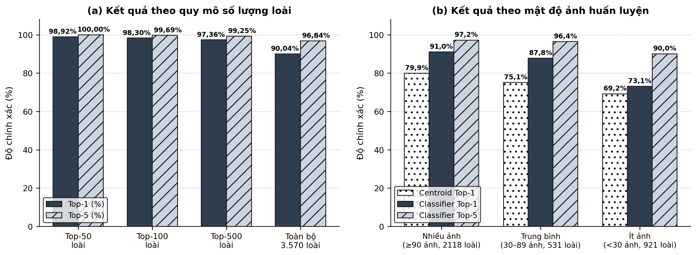
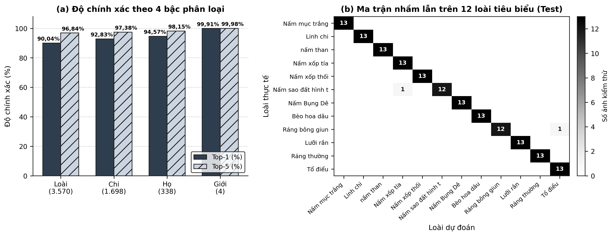
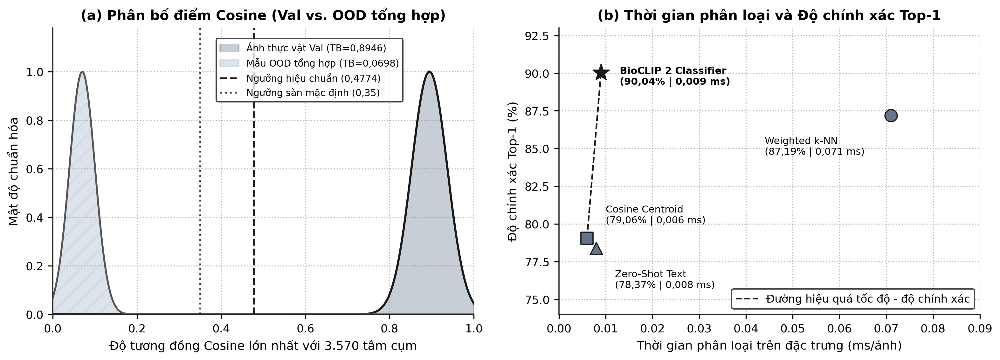

# BioLens Vietnam — Nhận diện Thực vật & Nấm Dược liệu Việt Nam (3.570 Loài)

Đồ án học phần **Học máy và Ứng dụng** (Khoa Công nghệ Thông tin, Trường Đại học Văn Lang).  
Hệ thống nhận diện qua ảnh và tra cứu thông tin thực vật, nấm dược liệu Việt Nam trên bộ dữ liệu **VietMediSpecies2026** (`3.570` loài có ảnh thực tế / `310.647` ảnh thực địa / `4.799` bản ghi chuẩn GBIF).

---

## 1. Tổng quan Hệ thống

Thay vì ghép nhiều mạng thị giác đa dụng gây nặng bộ nhớ, **BioLens Vietnam** sử dụng duy nhất mô hình nền thị giác - ngôn ngữ sinh học **BioCLIP 2** (`hf-hub:imageomics/bioclip-2`, kiến trúc `ViT-L/14` @ `224×224`, đặc trưng `768` chiều, huấn luyện trên 214 triệu ảnh sinh vật `TreeOfLife-200M`) cho toàn bộ quy trình:

1. **Trích xuất đặc trưng ảnh và văn bản phân loại học GBIF (`models/feature_extractor.py`)**:
   - Ảnh đầu vào được xoay theo EXIF, chuyển RGB, co giãn Bicubic cạnh ngắn (`235 px`), cắt tâm `224×224`, chuẩn hóa CLIP và hợp nhất 2 góc nhìn lật ngang (2-View Flip TTA) ở chế độ `FP16`.
   - Bộ mã hóa văn bản (Text Encoder) mã hóa chuỗi phân cấp GBIF (`Kingdom -> Class -> Order -> Family -> Genus -> Species`) của toàn bộ `3.570` loài thành ma trận `T (3570 × 768)`.
2. **Đầu phân loại triển khai chính thức `BioCLIP2TaxonomicClassifier` (`models/ml_classifiers.py`)**:
   - Nhánh dư `768 -> 1536 -> 768` (khởi tạo hệ số ghép dư `res_alpha = 0,0`, hội tụ về `0,0392`).
   - Khởi tạo ma trận trọng số `3.570` lớp kết hợp `0,35 × Text GBIF + 0,65 × Tâm cụm ảnh Train`.
   - Huấn luyện `50` vòng lặp (`AdamW`, `CosineAnnealingLR`) kết hợp hiệu chỉnh `Logit Adjustment` ($\tau = 0,50$ ở pha huấn luyện), `Feature Mixup` ($p = 0,25$), `Label Smoothing` ($0,06$) và `EMA` ($0,995$).
   - Tổng dung lượng bộ trọng số triển khai trên Web chỉ **`25,40 MB`** (tệp `bioclip2_classifier.pt` nặng `19,51 MB`).
3. **Bộ lọc từ chối ảnh kém chất lượng & ảnh ngoài miền (`models/ood_filter.py`)**:
   - **Tiền kiểm chất lượng ảnh**: kiểm tra độ nét Laplacian (`≥ 18,0`), độ sáng và độ tương phản.
   - **Tầng 1**: kết hợp kiểm định ngữ nghĩa Zero-Shot trên `11` câu mô tả miền và năng lượng chiếu lên không gian con PCA 64 chiều của `3.570` loài (`subspaceEnergy ≥ 0,62`).
   - **Tầng 2**: kiểm tra đồng thời ngưỡng Cosine cực đại theo chặn dưới $3,5\sigma$ của tập thực vật Validation (`≥ 0,7462`) và điểm `MaxLogit ≥ 6,5`.
4. **Ứng dụng Web FastAPI & Kiểm soát An toàn Dược liệu (`backend/`, `frontend/`)**:
   - Giao diện tải ảnh / chụp Camera WebRTC, tra cứu bách khoa `3.570` loài (hồ sơ 7 mục đối chiếu GBIF, POWO, Wikipedia Tiếng Việt).
   - Cơ sở dữ liệu `storage/catalog/nutraceutical_registry.json` phân định rõ `3.570` loài: `3.236` loài chỉ dùng làm thuốc chuyên khoa, `176` loài có độc tính cảnh báo không ăn uống, và `158` loài thuộc nhóm trà thảo mộc (`58`), gia vị (`56`), món ăn bồi bổ (`44`) với `70` loài đã có `87` công thức chi tiết.



---

## 2. Kết quả Thực nghiệm (Tập Test độc lập: `31.201` ảnh / `3.570` loài)

Dữ liệu `310.647` ảnh (`0` ảnh lỗi) được chia phân tầng (`seed = 42`) theo tỉ lệ 80/10/10: **Train `248.310` ảnh**, **Validation `31.136` ảnh**, **Test `31.201` ảnh**. Nhật ký huấn luyện gốc lưu tại [`storage/reports/train_bioclip2_fitlab.log`](storage/reports/train_bioclip2_fitlab.log) và kết quả JSON tại [`storage/reports/ml_benchmark_results.json`](storage/reports/ml_benchmark_results.json).

### 2.1. So sánh 4 phương pháp trên không gian đặc trưng BioCLIP 2 (`768` chiều)

| Phương pháp | Top-1 (%) | Top-3 (%) | Top-5 (%) | Macro-F1 (%) | Weighted-F1 (%) | Train (s) | Độ trễ phân loại (ms/ảnh) |
| :--- | :---: | :---: | :---: | :---: | :---: | :---: | :---: |
| BioCLIP 2 Zero-Shot (Text Prompt GBIF, 0 ảnh train) | 78,37 | 90,14 | 92,81 | 67,36 | 77,76 | 0,00 | 0,008 |
| Cosine Nearest Centroid | 79,06 | 89,66 | 92,25 | 73,86 | 79,59 | 0,309 | 0,006 |
| Weighted Cosine k-NN (`k = 21`) | 87,19 | 94,77 | 95,97 | 79,61 | 86,67 | 0,099 | 0,071 |
| **BioCLIP 2 Taxonomic Classifier (Mô hình chính)** | **90,04** | **95,68** | **96,84** | **84,63** | **89,74** | **316,73** | **0,009** |



### 2.2. Quá trình hội tụ huấn luyện (50 Epochs)
Hàm mất mát giảm từ `1,7665` (Epoch 1) xuống `0,9617` (Epoch 50); độ chính xác Validation đạt đỉnh **`89,83%`** tại **Epoch `40`** (so với Test **`90,04%`**, không có dấu hiệu quá khớp).



### 2.3. Đánh giá đa quy mô & Phân rã nhóm mật độ mẫu (Long-tail)

| Quy mô tập loài (chọn trên tập Validation) | Số ảnh Test | Top-1 (%) | Top-3 (%) | Top-5 (%) | Weighted-F1 (%) |
| :--- | :---: | :---: | :---: | :---: | :---: |
| Top-50 loài | 650 | **98,92** | 99,85 | **100,00** | 98,93 |
| Top-100 loài | 1.292 | **98,30** | 99,54 | 99,69 | 98,29 |
| Top-500 loài | 6.431 | **97,36** | 99,05 | 99,25 | 97,35 |
| Toàn bộ 3.570 loài | 31.201 | **90,04** | 95,68 | 96,84 | 89,74 |

| Nhóm mật độ mẫu huấn luyện | Số loài | Số ảnh Test | Centroid Top-1 (%) | Classifier Top-1 (%) | Classifier Top-5 (%) |
| :--- | :---: | :---: | :---: | :---: | :---: |
| Nhiều ảnh (`≥ 90` ảnh/loài) | 2.118 | 27.120 | 79,91 | **90,99** | **97,18** |
| Trung bình (`30 – 89` ảnh/loài) | 531 | 2.956 | 75,07 | **87,75** | **96,38** |
| Ít ảnh (`< 30` ảnh/loài) | 921 | 1.125 | 69,16 | **73,07** | **90,04** |



### 2.4. Độ chính xác phân cấp sinh học & Kiểm định OOD

| Bậc phân loại sinh học (GBIF) | Số lượng | Top-1 (%) | Top-5 (%) |
| :--- | :---: | :---: | :---: |
| Cấp Loài (Species) | 3.570 loài | 90,04 | 96,84 |
| Cấp Chi (Genus) | 1.698 chi | 92,83 | 97,38 |
| Cấp Họ (Family) | 338 họ | 94,57 | 98,15 |
| Cấp Giới (Kingdom) | 4 giới | 99,91 | 99,98 |





---

## 3. Hướng dẫn Cài đặt, Chạy Web & Huấn luyện lại

### 3.1. Cài đặt môi trường
```bash
git clone https://github.com/Duc-bug/BioLens.git
cd BioLens
python -m venv .venv

# Windows PowerShell:
.venv\Scripts\Activate.ps1
# Linux / macOS:
# source .venv/bin/activate

pip install -r requirements.txt
```

### 3.2. Chạy thử ứng dụng Web ngay (đã kèm sẵn trọng số BioCLIP 2)
Repo đã đính kèm sẵn trọng số `storage/checkpoints/bioclip2_classifier.pt` (`19,51 MB`), `cosine_prototypes.npz`, `ood_calibration.json` và danh mục tri thức `storage/catalog/`. Chỉ cần chạy:
```bash
python run_server.py
```
Mở trình duyệt tại `http://127.0.0.1:8000` (lần chạy đầu sẽ tự tải trọng số nền `imageomics/bioclip-2` từ HuggingFace Hub).

### 3.3. Huấn luyện lại từ đầu trên bộ ảnh gốc `VietMediSpecies2026`
1. Tải bộ dữ liệu gốc từ **Science Data Bank (SciDB)**:  
   https://www.scidb.cn/en/detail?dataSetId=d2e66ca3d73540739a39789d9b1cf989#p5
2. Giải nén thành thư mục chứa `VietMediSpecies2026_metadata_dataset.csv` và `3.570` thư mục loài, sau đó tạo file `.env` từ `.env.example` và trỏ biến `BIOLENS_DATASET_ROOT` tới thư mục dữ liệu.
3. Chạy lần lượt:
```bash
# Bước 1 (tùy chọn, đã có sẵn dataset_splits.json): quét thư mục và chia tập 80/10/10
python scripts/01_build_catalog.py

# Bước 2: trích xuất vector đặc trưng BioCLIP 2 (768 chiều, GPU FP16, có tự động lưu checkpoint)
python scripts/02_extract_features.py

# Bước 3: huấn luyện BioCLIP2TaxonomicClassifier, đánh giá đa quy mô & hiệu chuẩn OOD
python scripts/03_train_and_evaluate.py
```

---

## 4. Cấu trúc Thư mục

```text
BioLens/
├── configs/settings.py                  # Cấu hình đường dẫn và tham số mô hình
├── dataset/                             # Xây dựng danh mục GBIF & quy tắc dược liệu
├── models/
│   ├── feature_extractor.py             # Trích xuất đặc trưng ảnh & văn bản BioCLIP 2 (768d)
│   ├── ml_classifiers.py                # BioCLIP2TaxonomicClassifier & bộ đánh giá thực nghiệm
│   ├── ood_filter.py                    # Bộ lọc chất lượng ảnh & lọc ngoài miền 2 tầng
│   └── inference_engine.py              # Mô-đun suy luận thời gian thực
├── backend/                             # FastAPI REST API (14 endpoints /api)
├── frontend/                            # Giao diện Web nhận diện, tra cứu 3.570 loài & gợi ý dược thiện
├── scripts/                             # Kịch bản chuẩn bị dữ liệu, trích xuất và huấn luyện
├── docs/
│   ├── Bao_Cao_Toan_Tap_BioLens_Vietnam_VLU.docx
│   ├── ARCHITECTURE.md
│   └── diagrams/academic_bw/            # 8 sơ đồ & biểu đồ kết quả (300 DPI)
├── storage/
│   ├── catalog/                         # Danh mục 3.570 loài, chia tập & quy tắc an toàn dược thiện
│   ├── checkpoints/                     # Trọng số BioCLIP2TaxonomicClassifier, tâm cụm & OOD
│   ├── embeddings/                      # Vector văn bản GBIF & metadata trích xuất
│   └── reports/                         # Kết quả benchmark JSON & nhật ký train trên GPU
├── requirements.txt
└── run_server.py
```
