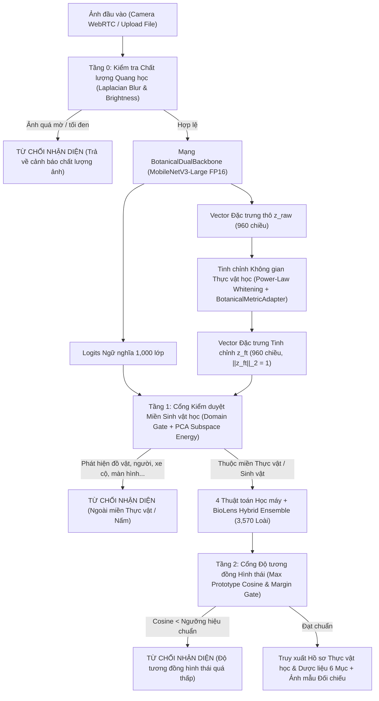

# Tài liệu Kiến trúc Hệ thống & Cơ sở Toán học — BioLens Vietnam

Tài liệu này mô tả chi tiết luồng xử lý dữ liệu, công thức toán học của **Bộ lọc Từ chối Ảnh ngoại lai 2 Tầng (2-Stage Open-Set OOD Filter)**, **Không gian Đặc trưng Thực vật học Đa nhiệm (Hierarchical Botanical Metric Adapter)** và **4 Thuật toán Học máy** trong hệ thống **BioLens**.

---

## 1. Sơ đồ Luồng Xử lý Tổng thể (End-to-End Pipeline)

---

## 2. Tinh chỉnh Không gian Đặc trưng (Phase 2 Feature-Space Fine-Tuning)

### 2.1. Chuẩn hóa Power-Law (Signed Power-Law Normalization & Centering)
Đặc trưng $\mathbf{z}_{\text{raw}} \in \mathbb{R}^{960}$ trích xuất từ `MobileNetV3-Large` thường có phân phối lệch (bursty activations) do ảnh hưởng bởi phông nền (đất, cỏ, lá khô). Hệ thống áp dụng phép biến đổi:

$$\tilde{\mathbf{z}} = \text{sign}(\mathbf{z}_{\text{raw}}) \odot |\mathbf{z}_{\text{raw}} + \epsilon|^{\beta}, \quad \beta = 0.55$$

$$\mathbf{z}_w = \frac{\tilde{\mathbf{z}} - \boldsymbol{\mu}_{\text{train}}}{\|\tilde{\mathbf{z}} - \boldsymbol{\mu}_{\text{train}}\|_2}$$

### 2.2. Mạng `BotanicalMetricAdapter` Đa nhiệm Phân cấp (Loài - Chi - Họ)
Mạng kết hợp nhánh **Squeeze-and-Excitation (SE) Channel Attention** và **Residual Bottleneck**, được huấn luyện đồng thời với hàm mất mát phân cấp thực vật học:

$$\mathcal{L}_{\text{Hier}} = \mathcal{L}_{\text{CE}}(\mathbf{y}_{\text{species}}, \hat{\mathbf{y}}_{\text{species}}) + 0.30\,\mathcal{L}_{\text{CE}}(\mathbf{y}_{\text{family}}, \hat{\mathbf{y}}_{\text{family}}) + 0.20\,\mathcal{L}_{\text{CE}}(\mathbf{y}_{\text{genus}}, \hat{\mathbf{y}}_{\text{genus}})$$

Nhờ hàm mất mát này, các loài thuộc cùng một **Chi (Genus)** hoặc **Họ (Family)** được gom lại gần nhau trên siêu cầu đơn vị $\mathbb{S}^{959}$, đồng thời tách biệt rõ các loài khác nhau.

---

## 3. Bốn Thuật toán Học máy & Mô hình Kết hợp (Hybrid Ensemble)

1. **Multi-Subcenter Attention-Pruned Cosine Prototype (`cosine_prototype`)**:
   - Lọc bỏ các ảnh mẫu bị nhiễu ngoại biên bằng trọng số tự chú ý $w_i = \exp(6.0 \cdot \cos(\mathbf{z}_i, \boldsymbol{\mu}_c^{(0)}))$.
   - Tách mỗi loài thành tâm chính $\boldsymbol{\mu}_c$ và 2 tâm phụ $(\boldsymbol{\mu}_{c,1}, \boldsymbol{\mu}_{c,2})$ đại diện cho hai nhóm hình thái (ví dụ: ảnh chụp Hoa/Quả vs ảnh chụp Lá/Thân).
2. **Inverse-Frequency Balanced Weighted Cosine $k$-NN (`weighted_knn`, $k=19$)**:
   - Tìm $k=19$ mẫu huấn luyện gần nhất trên GPU bằng phép nhân ma trận `FP16`.
   - Tính điểm bầu chọn có bù đắp tần suất lớp nghịch đảo $N_c^{-0.16}$ để bảo vệ các loài quý hiếm (Few-shot).
3. **Hard-Negative Large-Margin Multi-class Linear SVM (`linear_svm`)**:
   - Tối ưu hóa 3,570 siêu phẳng phân lớp với sự kết hợp giữa **Crammer-Singer Multi-margin Hinge Loss** ($\text{margin} = 1.2$) và **Logit-Adjusted Cross-Entropy**.
4. **Class-Balanced SE-Residual Cosine MLP (`cosine_mlp`)**:
   - Mạng Neural $960 \rightarrow 1408 \rightarrow 3570$ tích hợp cổng chú ý kênh SE-Residual, huấn luyện với **Feature-level Manifold Mixup** ($\alpha = 0.2$) và biên góc **CosFace** ($m = 0.10$) kèm bù đắp tiên nghiệm lớp $\tau \log \pi_c$.
5. **BioLens Hybrid Ensemble (`ensemble`)**:
   - Kết hợp tuyến tính có hiệu chuẩn trên tập Validation giữa cả 4 thuật toán trên để đạt độ chính xác cao nhất ở mọi quy mô.

---

## 4. Bộ lọc Từ chối Nhận diện 2 Tầng (2-Stage Open-Set OOD Filter)

Khi người dùng chụp một vật thể không phải thực vật (con người, bàn ghế, điện thoại, màn hình máy tính, xe cộ, thú cưng) hoặc ảnh bị che tối/mờ nhòe:

- **Tầng 0 (Optical Quality Gate)**: Kiểm tra phương sai Laplacian ($\text{Var}(\nabla^2 I) \ge 18.0$) và độ sáng trung bình ($15 \le \bar{I} \le 250$).
- **Tầng 1 (Semantic & Botanical PCA Subspace Gate)**: Kiểm tra tổng xác suất nhóm lớp nhân tạo/động vật và tính năng lượng hình chiếu của vector đặc trưng lên không gian con 64 trục chính (PCA Subspace) của 3,570 loài thực vật.
- **Tầng 2 (Calibrated Prototype Cosine Gate)**: Kiểm tra độ tương đồng góc Cosine lớn nhất $\max_c \cos(\mathbf{z}_{\text{ft}}, \boldsymbol{\mu}_c)$ so với ngưỡng hiệu chuẩn ROC-AUC trên tập Validation.
