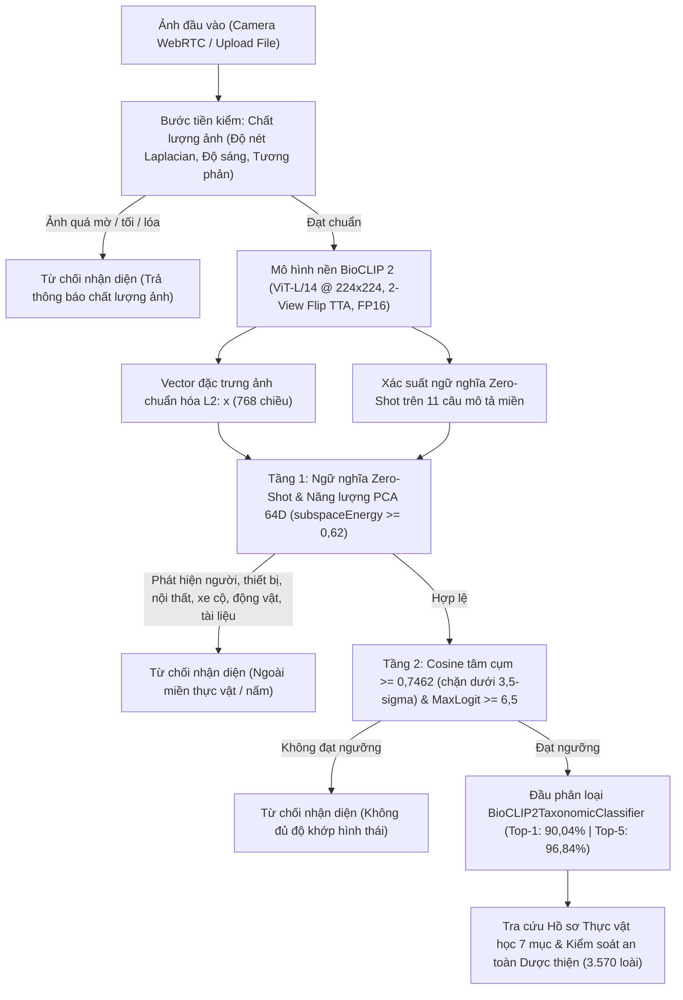

# Tài liệu Kiến trúc Hệ thống & Cơ sở Toán học — BioLens Vietnam

Tài liệu này mô tả luồng xử lý đầu-cuối, các công thức toán học của mô hình nền sinh học **BioCLIP 2**, đầu phân loại tinh chỉnh **`BioCLIP2TaxonomicClassifier`**, **Bộ lọc từ chối ảnh ngoài miền 2 tầng (`TwoStageOODFilter`)** và **Mô-đun gợi ý dược thiện có kiểm soát an toàn** trong dự án **BioLens Vietnam**.

---

## 1. Sơ đồ Luồng Xử lý Tổng thể

---

## 2. Biểu diễn Đa phương thức trên BioCLIP 2 (`models/feature_extractor.py`)

### 2.1. Biểu diễn hình ảnh 2 góc nhìn (`768` chiều)
Ảnh $I$ được xoay theo thẻ EXIF, chuyển sang RGB, co giãn Bicubic cạnh ngắn về $\text{round}(224 \times 1,05) = 235$ pixel, cắt tâm $224 \times 224$ và chuẩn hóa theo trung bình, độ lệch chuẩn CLIP. Với ảnh gốc $I$ và ảnh lật ngang $\tilde{I}$:

$$\mathbf{f}_1 = \text{norm}_2(f_{\text{img}}(I)), \quad \mathbf{f}_2 = \text{norm}_2(f_{\text{img}}(\tilde{I})), \quad \mathbf{x} = \text{norm}_2(\mathbf{f}_1 + \mathbf{f}_2) \in \mathbb{R}^{768}$$

### 2.2. Biểu diễn văn bản phân cấp GBIF (`3570 × 768`)
Với mỗi loài $c \in \{1, \dots, 3570\}$, Text Encoder của BioCLIP 2 mã hóa câu phân cấp đầy đủ (`"a photo of <Kingdom> <Class> <Order> <Family> <Genus> <CanonicalName>"`) thành $\mathbf{e}_{1,c}$ và câu ngắn (`"a photo of <CanonicalName>"`) thành $\mathbf{e}_{2,c}$:

$$\mathbf{t}_c = \text{norm}_2(0,65\,\mathbf{e}_{1,c} + 0,35\,\mathbf{e}_{2,c}) \in \mathbb{R}^{768}$$

---

## 3. Đầu Phân loại `BioCLIP2TaxonomicClassifier` (`models/ml_classifiers.py`)

- **Nhánh dư tinh chỉnh đặc trưng:** `Dropout(0,08) -> Linear(768, 1536) -> BatchNorm1d -> GELU -> Dropout(0,22) -> Linear(1536, 768) -> BatchNorm1d` tạo $\Delta(\mathbf{x})$:

$$\mathbf{z} = \text{norm}_2(\mathbf{x} + \alpha\,\Delta(\mathbf{x})), \quad \alpha_0 = 0,0 \text{ (hội tụ tại } \alpha = 0,0392\text{)}$$

- **Khởi tạo ma trận trọng số lớp kết hợp văn bản GBIF và tâm cụm ảnh huấn luyện $\mathbf{C}$:**

$$\mathbf{W}_0 = \text{norm}_2(0,35\,\mathbf{T} + 0,65\,\mathbf{C}) \in \mathbb{R}^{3570 \times 768}$$

- **Hàm mất mát lúc huấn luyện (Logit Adjustment $\tau = 0,50$, Label Smoothing $0,06$, Feature Mixup $p = 0,25$, EMA $0,995$):**

$$\ell_c^{\text{train}}(\mathbf{x}) = 26,0 \cdot \mathbf{z}^\top \text{norm}_2(\mathbf{w}_c) + 0,50 \log(\pi_c + 10^{-8})$$

- **Điểm số lúc suy luận:** $\ell_c^{\text{infer}}(\mathbf{x}) = 26,0 \cdot \mathbf{z}^\top \text{norm}_2(\mathbf{w}_c)$ (trên giao diện Web chia hệ số nhiệt độ $1,4$ trước Softmax).

---

## 4. Tóm tắt Kết quả Thực nghiệm (`storage/reports/ml_benchmark_results.json`)

- **Bộ dữ liệu `VietMediSpecies2026`:** `310.647` ảnh hợp lệ / `3.570` loài (`Train: 248.310`, `Val: 31.136`, `Test: 31.201`).
- **Kết quả trên tập Test (`31.201` ảnh):**
  - `BioCLIP 2 Zero-Shot (Text Prompt)`: Top-1 `78,37%` | Top-5 `92,81%` | Weighted-F1 `77,76%`.
  - `Cosine Nearest Centroid`: Top-1 `79,06%` | Top-5 `92,25%` | Weighted-F1 `79,59%`.
  - `Weighted Cosine k-NN (k = 21)`: Top-1 `87,19%` | Top-5 `95,97%` | Weighted-F1 `86,67%`.
  - **`BioCLIP 2 Taxonomic Classifier` (Mô hình triển khai):** Top-1 **`90,04%`** | Top-3 **`95,68%`** | Top-5 **`96,84%`** | Macro-F1 **`84,63%`** | Weighted-F1 **`89,74%`** | Độ trễ đầu phân loại **`0,009 ms/ảnh`**.
- **Phân định an toàn `nutraceutical_registry.json` (`3.570` loài):** `MEDICINAL_ONLY: 3.236`, `TOXIC_FORBIDDEN: 176`, `BEVERAGE_INFUSION: 58`, `SPICE_AROMATIC: 56`, `CULINARY_TONIC: 44` (`70` loài có `87` công thức định lượng chi tiết).
